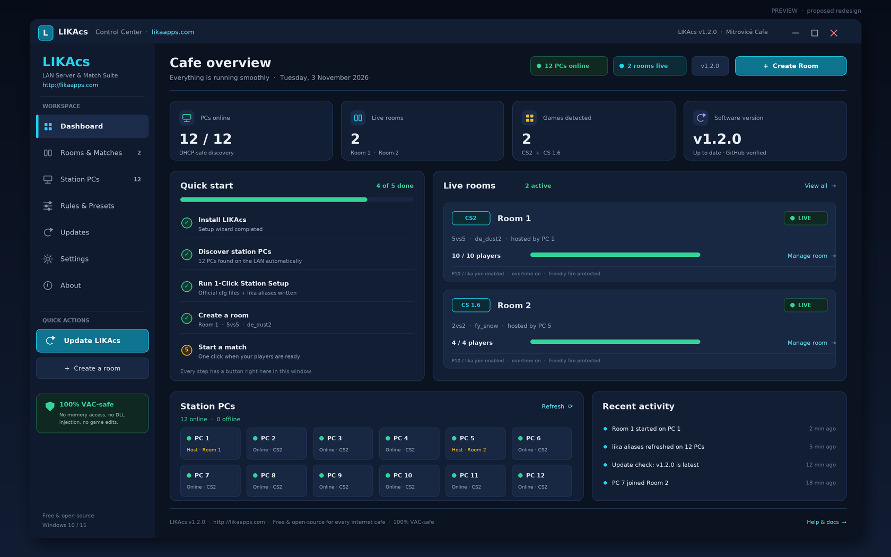
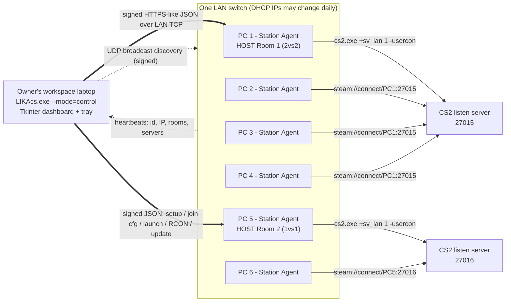

# LIKAcs

**100% free & open-source • 100% VAC-safe • Windows 10 / Windows 11 • CS2 + Counter-Strike 1.6 LAN Server & Match Management Suite for internet cafes of any size**

> Official website: **[likaapps.com](http://likaapps.com)** — <http://likaapps.com>  
> Source & releases: <https://github.com/azyoff/LIKAcs>

LIKAcs turns any LAN switch (2 PCs → 50+ PCs) into a cafe match-management system. Run several rooms at the same time, route every PC to *its own* room with one word or one key, and control live matches from the owner's laptop — **without SteamCMD, without a 60 GB extra download, and without touching game memory**.

| | |
|---|---|
| Games | Counter-Strike 2 (`cs2.exe`) and Counter-Strike 1.6 (`hl.exe` / `hlds.exe`) |
| Presets | `1vs1`, `2vs2`, `2vs3`, `3vs3`, `4vs4`, `5vs5`, `Wingman (2vs2 half-map)`, `Deathmatch / Warmup`, `Custom` |
| Maps | `de_dust2` (default), `de_mirage`, `de_inferno`, `de_nuke`, `de_anubis`, `de_ancient`, `de_vertigo`, `de_train` + CS 1.6 classics `fy_snow`, `aim_map`, `de_aztec`, `cs_assault` + any custom map name |
| Host | The **already installed** Steam game on a gaming PC. The player sitting at the host PC can play too. |
| Laptop | Lightweight remote Control Center — a few MB, **no Steam, no CS2 install, no Python, no Node** required. The same Control Panel can also be opened directly on PC 1 / PC 2 / any gaming PC. |
| Updates | **One click in the app** → GitHub Releases → SHA-256 verified → self-install with rollback; optionally push the same verified exe to every LAN Station PC |



*Design preview — the v1.2.0 Control Center: sidebar navigation, Cafe overview
dashboard with KPI cards and a Quick start checklist, live rooms, station PCs
and recent activity. All text and branding shown are from the real app.*


---

## Contents

1. [The 100% VAC-safe promise](#the-100-vac-safe-promise)
2. [Architecture](#architecture)
3. [Install (one download, one wizard)](#install-one-download-one-wizard)
4. [The Control Center workspace](#the-control-center-workspace)
5. [Quick start for a cafe](#quick-start-for-a-cafe)
6. [1-Click Station Setup](#1-click-station-setup)
7. [Multiple simultaneous rooms](#multiple-simultaneous-rooms)
8. [Smart `lika` join and F10](#smart-lika-join-and-f10)
9. [Cafe rules & live controls](#cafe-rules--live-controls)
10. [System tray, tooltip and auto-start](#system-tray-tooltip-and-auto-start)
11. [Start & Connect Selected PCs](#start--connect-selected-pcs)
12. [Updates: GitHub → laptop → all cafe PCs](#updates-github--laptop--all-cafe-pcs)
13. [Standalone .exe and GitHub Actions](#standalone-exe-and-github-actions)
14. [Ports, firewall & LAN keys](#ports-firewall--lan-keys)
15. [Troubleshooting](#troubleshooting)
16. [Development](#development)
17. [License](#license)

---

## The 100% VAC-safe promise

LIKAcs contains **zero cheats** and uses **only first-party mechanisms**:

✅ official config files (`autoexec.cfg` + `exec lika_autoexec.cfg` for CS2, `userconfig.cfg` for CS 1.6, plus dynamically rewritten `lika_join.cfg` / `lika_room1..3.cfg` / `lika_match.cfg`)  
✅ official launch parameters (`-usercon`, `+rcon_password`, `+sv_lan 1`, `+map`, `+maxplayers`, `-port`, `+exec`)  
✅ official RCON (Source RCON over TCP for CS2, GoldSrc UDP challenge RCON for CS 1.6)  
✅ official `steam://connect/<host_ip>:<port>` and `steam://rungameid/...` protocol  
✅ ordinary OS process start/stop (graceful `WM_CLOSE`, then `taskkill`)

❌ **never** reads or writes game process memory  
❌ **never** injects a DLL, hooks the engine or simulates cheats  
❌ **never** modifies game binaries, and **never disables VAC** (no `-insecure`)  
❌ **never** overwrites a player's crosshair, mouse sensitivity or other keybinds — only an explicitly-visible `exec` hook line and the `F10` bind are added

A CI guard ([`scripts/verify_vac_safety.py`](scripts/verify_vac_safety.py)) scans the real code tokens (comments/strings stripped) and **fails any build** if memory APIs, injection or binary patching appear. See [`docs/VAC_SAFETY.md`](docs/VAC_SAFETY.md).

---

## Architecture



| Layer | Implementation |
|---|---|
| Runtime | **Python 3.11 standard library only** (`tkinter`, `socket`, `http.server`, `urllib`, `ctypes`, `winreg`). Zero third-party runtime dependencies. |
| Discovery | UDP broadcast / directed-broadcast heartbeats on port `27055`, every 2 s. HMAC-signed, replay-protected. Station IDs are stable UUIDs — DHCP changes are irrelevant. |
| Control | Signed HTTP/JSON API on each Station Agent (`27056`). Every request has a timestamp, nonce and HMAC-SHA256 signature over the body. |
| Rooms | Persisted in `%APPDATA%\LIKAcs\rooms.json`; per-room host, PCs, preset, map, rules, port, RCON password, state. |
| Join routing | `alias lika "exec lika_join.cfg"` — `exec` reads the tiny target file **from disk at the moment the alias is used**, so retargeting works **even while CS2 / CS 1.6 is open**. |
| Tray | `Shell_NotifyIconW` via `ctypes` — no `pystray`/Pillow dependency; the icon is generated in memory. |
| Build | PyInstaller in GitHub Actions → **one** `LIKAcs.exe` on the Release page + `latest.json` / `SHA256SUMS.txt` for verified one-click updates. Optional Setup / shortcut exes are Actions artifacts. |

More detail: [`docs/ARCHITECTURE.md`](docs/ARCHITECTURE.md), [`docs/CFG_REFERENCE.md`](docs/CFG_REFERENCE.md), [`docs/PORTS.md`](docs/PORTS.md).

---

## Install (one download, one wizard)

**[Download `LIKAcs.exe`](https://github.com/azyoff/LIKAcs/releases/latest)** —
it is the only `.exe` on the Releases page. Double-click it:

1. The **LIKAcs Setup** wizard opens on the first run. Choose the folder,
   Desktop / Start Menu shortcuts and whether the Station Agent should start
   silently with Windows. No UAC prompt, no administrator account, no reboot.
2. Click **Install**. LIKAcs copies itself to
   `%LOCALAPPDATA%\LIKAcs\LIKAcs.exe`, registers a real **Apps & features**
   uninstall entry, creates the shortcuts and launches the app.
3. Every later launch is the app itself. Updates need just one click inside
   the app — you never download or copy an `.exe` again.

Windows SmartScreen may warn about a new unsigned build: click **More info →
Run anyway**. You can verify the file with `SHA256SUMS.txt` on the Release page.
To remove everything, use Windows **Settings → Apps → Installed apps → LIKAcs →
Uninstall** (or run `LIKAcs.exe --mode=uninstall`). Cafe settings in
`%APPDATA%\LIKAcs\` are kept.

> **IT / silent rollout:** the workflow build artifact also contains
> `LIKAcs-Setup.exe` for unattended deployment:
> `LIKAcs-Setup.exe --silent --autostart --no-launch`. It is intentionally not
> attached to the Releases page, so there is never a confusing choice of exes.

---

## The Control Center workspace

The owner's laptop opens on the **Cafe overview** dashboard. The left sidebar
never moves: Dashboard, Rooms & Matches, Station PCs, Rules & Presets, Updates,
Settings and About, plus permanent **Update LIKAcs** and **Create a room**
buttons, a VAC-safe badge and the likaapps.com help link.

At a glance you get header status pills, four KPI cards (PCs online, live rooms,
games detected, software version), a **Quick start** checklist that tracks your
first five setup steps, live room cards with a one-click "Manage room" jump, a
12-PC station grid that marks hosts, and a Recent activity feed. Everything
updates live every 1.5 s — no tab hunting and no manual refreshing.

---

## Quick start for a cafe

1. **Install once per PC** with [`LIKAcs.exe`](https://github.com/azyoff/LIKAcs/releases/latest) as described above. No Python, no SteamCMD, no admin rights.
2. **Laptop / owner desk:** open **LIKAcs** from the Start Menu → **"Open Control Center"**. No Steam or CS installation is needed here.
3. **Every gaming PC:** install the same file, or push `LIKAcs-Setup.exe --silent`, then open **LIKAcs Station Agent** from the Start Menu. It minimizes to the tray.
4. On each gaming PC click **1-Click Station Setup**. Then click **Firewall Rules (UAC)** once and accept the Windows UAC prompt (or use the laptop's **Station PCs** tab to do all of them). Optionally enable **Auto-start ON** so the agent starts silently with Windows.
5. In the Control Center, wait a few seconds — PCs appear automatically in **Station PCs** with their current DHCP IPs. Rename them to `PC 1`, `PC 2`, ... if you like.
6. In **Rooms & Matches**, create a room, choose game / preset / map / Host PC, tick the PCs in the checklist, click **Apply PC assignment**, then **Start Room**.
7. On each assigned PC: press <code>`</code> → type `lika` → Enter, **or just press `F10`**. Alternatively tick the PCs on the laptop and click **Start & Connect Selected PCs**.

> Want the Control Panel on a gaming PC instead of a laptop? Just run `LIKAcs.exe` there too and pick **Open Control Center** — both roles can run on the same machine.

---

## 1-Click Station Setup

`LIKAcs` auto-detects Steam libraries on **C:, D:, E:, ...** by parsing the official `steamapps/libraryfolders.vdf`, plus common install locations. It locates:

* CS2: `...\Counter-Strike Global Offensive\game\bin\win64\cs2.exe` and `game\csgo\cfg\`
* CS 1.6: `...\Half-Life\hl.exe`, `hlds.exe` and `cstrike\cfg\`

Then it:

1. Enables the developer console with the official cvar (`con_enable 1` for CS2, `console 1` for CS 1.6).
2. Creates a timestamped backup of `autoexec.cfg` / `userconfig.cfg` before the **first** modification.
3. Appends a clearly delimited 3-line managed block containing `exec lika_autoexec.cfg` — **idempotently** (running setup again never duplicates it) and without deleting any existing line.
4. Writes `lika_autoexec.cfg` (aliases + F10 bind), `lika_join.cfg`, `lika_room1..3.cfg` and `lika_match.cfg`.
5. Optionally adds **LAN-only** Windows Defender Firewall allow rules (`remoteip=localsubnet`) for CS2, CS 1.6, the agent and the LIKAcs ports, and optionally registers silent auto-start in `HKCU\...\Run`.

Manual paths (non-Steam installs, unusual drives) can be set in `settings.json` → `game_paths`.

---

## Multiple simultaneous rooms

Rooms are independent: each has its own host PC, port, RCON password, rules, map and PC assignment. Different hosts can even use the same game port (different IPs); LIKAcs still allocates `27015`, `27016`, ... to keep everything unambiguous.

**Example** — Room 1: `2vs2` on PC 1–4 hosted by PC 1, Room 2: `1vs1` on PC 5–6 hosted by PC 5, at the same time on the same switch:

| PC | `lika_join.cfg` | `lika1` | `lika2` |
|---|---|---|---|
| PC 1 (host 1) | `connect <PC1-IP>:27015` | Room 1 | Room 2 |
| PC 2, 3, 4 | `connect <PC1-IP>:27015` | Room 1 | Room 2 |
| PC 5 (host 2) | `connect <PC5-IP>:27016` | Room 1 | Room 2 |
| PC 6 | `connect <PC5-IP>:27016` | Room 1 | Room 2 |

A PC can only be assigned to one room; assigning it elsewhere removes it from the old room and immediately rewrites its cfg files. The host PC is always included in its own room (the host can play).

---

## Smart `lika` join and F10

```
autoexec.cfg (CS2) / userconfig.cfg (CS 1.6)
  └─ exec lika_autoexec.cfg
       ├─ alias "lika"  "exec lika_join.cfg"       ← typed word / F10
       ├─ alias "lika1" "exec lika_room1.cfg"      ← specific rooms
       ├─ alias "lika2" "exec lika_room2.cfg"
       ├─ alias "lika3" "exec lika_room3.cfg"
       ├─ unbind "F10" ; bind "F10" "lika"
       └─ con_enable 1 / console 1
lika_join.cfg  →  connect <assigned_host_ip>:<port>
```

Because `exec` reads the file **at invocation time**, the agent only rewrites `lika_join.cfg` (or `lika_roomN.cfg`) on disk — no game restart, no console command injection, no input simulation. CS 1.6's default `F10` is simply `bind "F10" "quit prompt"` in `config.cfg`, and `userconfig.cfg` is exec'd last, so our rebind cleanly replaces it. Change the join word or the key in **Settings** → **Save & Sync to All Station PCs**; `lika` always stays available as the default.

---

## Cafe rules & live controls

Pre-loaded, editable **per room** in the **Cafe Rules** tab:

| cvar | Value | Why |
|---|---|---|
| `sv_lan` | `1` | 100% local LAN switch traffic, ~1 ms ping, no Steam friends needed |
| `mp_freezetime` | `3` | short freeze |
| `mp_friendlyfire` | `1` | classic cafe rules |
| `mp_autokick` / `mp_tkpunish` | `0` | teammates never get auto-kicked / TK-banned |
| `mp_autoteambalance` | `0` | no forced team moves |
| `mp_limitteams` | `0` | uneven `2vs3` always works |
| `mp_forcecamera` | `1` | anti-ghosting: dead players spectate teammates only |
| `bot_quota` | `0` | no bots steal player slots |
| — | `mp_warmup_end` | automatic once the room is ready |
| — | Overtime ON/OFF | `mp_overtime_enable` / `mp_maxrounds` on CS2 |

Extra game-specific cvars (buy time, round time, halftime, max rounds, `mp_forcechasecam 2` on CS 1.6, Wingman `game_mode 2`, Deathmatch respawns...) are generated automatically. You can add any official cvar in the Rules tab.

**Live remote controls from the laptop** (official RCON through the host agent):

`Start Room` · `Stop Room` · **Knife Round → Swap Teams → LIVE! Restart Match (0-0)** · `Pause Match` / `Unpause Match` · `End Warmup` · `Kick Bots` · `Change Map Live` · `Re-apply Room Rules` · `Restart Round` · `Disconnect / Return Selected PCs to Main Menu` (RCON `kickid` / `kick #` by LAN IP parsed from `status`) · `Close Game` (graceful process shutdown).

> CS 1.6 notes: vanilla HLDS may need AMX Mod X for `mp_swapteams`; there is no `mp_warmup_end`, so "End Warmup" restarts the round. LIKAcs reports any unknown RCON command back in the UI instead of pretending it worked.

---

## System tray, tooltip and auto-start

Both the Control Center and the Station Agent minimize cleanly to the Windows 10/11 notification area (closing the window = minimize; **Exit** is in the tray menu). Hovering shows a **live** tooltip, e.g.:

```
LIKAcs (likaapps.com) | Room 1: 2vs2 playing | Room 2: 1vs1 playing | click for full status
```

Windows caps `NOTIFYICONDATA.szTip` at **127 characters**; `fit_tray_tooltip()` truncates gracefully and adds `+N more`. A **right-click** (or left-click for the window) shows the full live status menu with every active room, station count, a clickable **[likaapps.com](http://likaapps.com)** item, **Update LIKAcs from GitHub**, About and Exit. Enable **Auto-start ON** for silent boot (`--mode=station --silent`).

---

## Start & Connect Selected PCs

Tick `[x] PC 1  [x] PC 2 ...` and click **Start & Connect Selected PCs**. The laptop sends a signed command to each selected Station Agent, which locally opens the official Steam URLs:

```
steam://rungameid/730            (CS2)      steam://rungameid/10   (CS 1.6)
steam://connect/<host_ip>:<port>
```

For CS 1.6 there is also an optional fallback using the official `hl.exe -game cstrike +connect <ip>:<port>` launch parameter if the Steam URL handler is unavailable. No keystrokes are simulated and no game process memory is touched.

---

## Updates: GitHub → laptop → all cafe PCs

**To update an installed PC: click `Update LIKAcs` once.** It is in the header,
the Updates tab, the tray right-click menu, the About dialog and the Station
Agent window. There is nothing else to do.

1. The app reads `latest.json` from the stable
   `.../releases/latest/download/latest.json` URL (no API rate limits), then
   checks the version against the installed one. It also falls back to the
   GitHub Releases API if that asset is unavailable.
2. It downloads the new `LIKAcs.exe` and verifies its SHA-256 against **both**
   the manifest and `SHA256SUMS.txt`. Any mismatch discards the download —
   nothing on disk changes.
3. Because Windows locks a running `.exe`, a small `.cmd` helper waits for
   LIKAcs to exit, keeps a `.bak`, swaps the file, runs
   `LIKAcs.exe --version` to prove the new build boots, **rolls back
   automatically** if it does not, then relaunches with the same arguments.
4. Games keep running; a live match is never interrupted.

**Cafe-wide rollout (advanced):** in the Control Center's Updates tab, click
**Push update to ALL Station PCs**. One verified download is streamed in signed
512 KiB chunks to every discovered agent; each agent re-verifies the hash and
size before staging, and optionally restarts silently. That is the same
mechanism used by the one-click button, extended across the LAN.

For maintainers: tag `v1.2.0` and
[`.github/workflows/release.yml`](.github/workflows/release.yml) rebuilds the
exes, renders all five windows against a real Tk root (from source **and**
inside the built `.exe`), runs the installer smoke test, writes `latest.json`
and publishes `LIKAcs.exe` + `latest.json` + `SHA256SUMS.txt`.

See [`docs/UPDATE_FLOW.md`](docs/UPDATE_FLOW.md).

---

## Standalone .exe and GitHub Actions

**GitHub Releases publish only `LIKAcs.exe`** — one file for everything.
Windows 10/11, 64-bit, no Python/Node, no administrator rights. That one file
is both the installer (first run) and the app (every later run).

| File | Where | Purpose |
|---|---|---|
| `LIKAcs.exe` | **Release** | **The one you download.** Setup wizard on first run, then the app. Also the asset the one-click updater downloads. |
| `latest.json` | Release | Version, release notes, SHA-256 and download URL for the updater (read from `/releases/latest/download/`, no rate limits). |
| `SHA256SUMS.txt` | Release | Independent checksums, cross-checked by the updater. |
| `README.md`, `LICENSE` | Release | Documentation and MIT license. |
| `LIKAcs-Setup.exe` | Actions artifact | Optional silent deployment (`--silent --autostart --smoke-install`). Not on the Releases page. |
| `LIKAcs-ControlCenter.exe`, `LIKAcs-StationAgent.exe` | Actions artifact | Optional one-click shortcuts. Not on the Releases page. |

Useful switches: `--silent` (tray only), `--setup` (force the Setup wizard),
`--mode=control` / `--mode=station`, `--mode=setup` (headless first-time
station setup), `--mode=uninstall`, `--check-update` (JSON, no install),
`--update` (headless one-click update), `--self-test`, `--smoke-gui`, `--version`.

> Older tags **`v1`** and **`v1.0.1`** contain broken Windows builds. Use the latest release.

To build locally on Windows:

```powershell
git clone https://github.com/azyoff/LIKAcs.git
cd LIKAcs
python -m pip install -r requirements-build.txt   # PyInstaller, build-time only
python scripts\build.py                            # -> dist\*.exe + SHA256SUMS.txt
```

`release.yml` runs on `v*` tags (and `workflow_dispatch` with a tag input), executes the VAC-safety guard + unit tests + in-exe self-test, then publishes the Release. `ci.yml` runs the same checks plus a quick PyInstaller smoke build on every push/PR.

---

## Ports, firewall & LAN keys

| Port | Protocol | Use |
|---|---|---|
| `27055` | UDP broadcast | Signed discovery heartbeats / probes |
| `27056` | TCP | Signed Control Center → Station Agent JSON API |
| `27015`+ | UDP/TCP | Official game server ports (Room 1 = 27015, Room 2 = 27016, ...) |

All ports are configurable in **Settings**. Firewall rules are scoped to `remoteip=localsubnet` (LAN only). Every discovery packet and HTTP request is HMAC-SHA256 signed with the **LAN shared key** (default `lika-lan`) plus timestamp + nonce replay protection. Change the key in Settings and **Save & Sync to All Station PCs** — the agents hot-swap the key without restarting. For a shared/public network, set a strong key and make sure PC clocks are within ~90 seconds.

---

## Troubleshooting

| Symptom | Fix |
|---|---|
| No PCs appear in the laptop | Same LAN switch / same subnet, allow UDP 27055 + TCP 27056 (run **Firewall Rules (UAC)**), check both apps use the same LAN key, allow private-network discovery in Windows. |
| "bad signature" / "stale timestamp" | LAN keys differ or PC clocks drift. Sync clocks, then Settings → Save & Sync. |
| `lika` does nothing | Run 1-Click Setup on that PC, confirm `exec lika_autoexec.cfg` is in `autoexec.cfg`, check the console is enabled, and make sure the room is **live**. `lika_join.cfg` should contain `connect <ip>:<port>`. |
| F10 still shows the CS 1.6 quit prompt | `userconfig.cfg` must be exec'd last by `config.cfg` (Steam default). Re-run 1-Click Setup; optionally pick another key in Settings. |
| RCON commands fail | Start the room first, confirm the host PC is online, check that `-usercon` + `rcon_password` were passed and that no other server owns the port. Unknown CS 1.6 commands are reported in the log. |
| Host PC can't play | Use `Server mode = listen` (default). CS 1.6 `dedicated` mode also auto-launches a local `hl.exe` client connected to `127.0.0.1`. |
| Steam URL does nothing | Steam must be installed on the gaming PC (it already is — that's where CS2/1.6 came from). For CS 1.6 enable the `+connect` fallback. |
| Update did not apply | Click **Update LIKAcs** again. A failed download or boot check rolls back automatically and leaves a `LIKAcs.exe.update-failed` marker; check `%APPDATA%\LIKAcs\logs\LIKAcs.log`. For LAN pushes, tick "Restart Station Agents after push". |

Logs live in the UI log panel and in `%APPDATA%\LIKAcs\logs\LIKAcs.log`; setup / firewall reports and `install.json` are saved in `%APPDATA%\LIKAcs\` and `%LOCALAPPDATA%\LIKAcs\` respectively. Friendly error dialogs include **Copy details** and **Open log** buttons — no raw tracebacks.

---

## Development

```bash
export PYTHONPATH=src                     # Windows: set PYTHONPATH=src
python -m likacs --self-test              # headless checks (no GUI/Steam needed)
python -m unittest discover -s tests -v  # full unit + integration suite
python scripts/verify_vac_safety.py      # CI VAC-safety guard
python -m likacs --mode=control          # run the dashboard from source
```

Layout: `src/likacs/` → `agent.py`, `control.py`, `cfgs.py`, `network.py`, `http_api.py`, `rcon.py`, `games.py`, `rules.py`, `paths.py`, `setup_windows.py`, `update.py`, `selfupdate.py`, `installer.py`, `runtime.py`, `tray.py`, `state.py`, `security.py`, `ui/` (including `setup_wizard.py` and `update_panel.py`). Tests in `tests/`, docs in `docs/`, release automation in `.github/workflows/`. See [`CONTRIBUTING.md`](CONTRIBUTING.md).

---

## License

[MIT](LICENSE) — free and open-source for every internet cafe owner worldwide.  
© 2026 azyoff / LIKAcs — <http://likaapps.com>

*Counter-Strike and Steam are trademarks of Valve Corporation. LIKAcs is an independent, unofficial, open-source tool and is not affiliated with Valve.*
